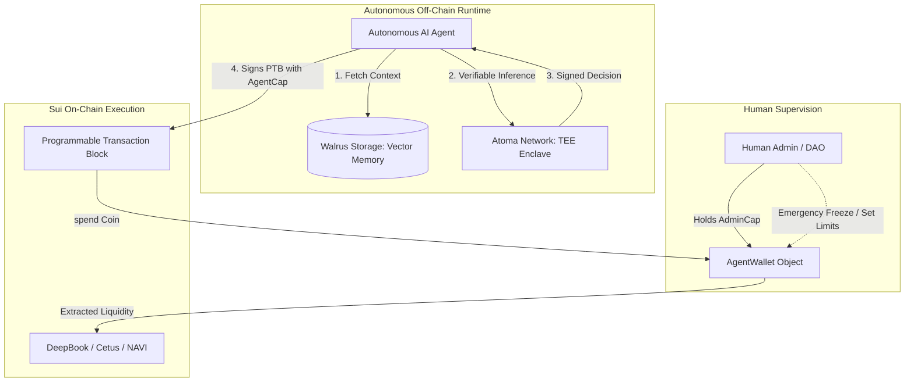

# 🌊 Sui On-Chain AI Agent Starter Kit

[](https://docs.sui.io/)
[](https://sui.io/)
[](LICENSE)
[](https://x.com/suiprofile)

The institutional open-source blueprint for deploying **autonomous, prompt-injection-resistant AI agents** on [Sui Network](https://sui.io). Built with **Move 2024 object capabilities**, sub-390ms **Mysticeti consensus**, persistent memory via **Walrus Protocol**, and verifiable compute via **Atoma Network TEEs**.

Developed by **SUI World Research** (`@suiprofile` / `@suiworld_ai`) as part of the **Sui Foundation Ecosystem Grant Milestone 2**.

---

## 🚀 Live Mainnet Deployments

| Asset | Identifier / Type | Explorer |
| :--- | :--- | :--- |
| **Package ID** | `0xdd6e0aabe4cac474cb85cc2955a84ef1f189300aeeb0a85aaa56c5442be46eba` | [SuiScan](https://suiscan.xyz/mainnet/object/0xdd6e0aabe4cac474cb85cc2955a84ef1f189300aeeb0a85aaa56c5442be46eba) |
| **$AGENT Token** | `0xdd6e0aabe4cac474cb85cc2955a84ef1f189300aeeb0a85aaa56c5442be46eba::agent::AGENT` | [SuiVision](https://suivision.xyz/coin/0xdd6e0aabe4cac474cb85cc2955a84ef1f189300aeeb0a85aaa56c5442be46eba::agent::AGENT) |
| **Deploy Transaction** | `Fisqb2v1DbRYaFfj7ajMRmPxXnSL3mB7EnNfV2StPdxm` | [View Tx](https://suiscan.xyz/mainnet/tx/Fisqb2v1DbRYaFfj7ajMRmPxXnSL3mB7EnNfV2StPdxm) |
| **Initial Supply** | `1,000,000,000 $AGENT` (9 Decimals) | Verified Immutable Metadata |

---

## 🏛 Architecture Overview



---

## 🛡 Key Security Primitives

Unlike traditional EVM or Solana agent architectures where an AI bot possesses raw private keys with unlimited spending power (creating catastrophic prompt-injection risk), this kit enforces strict **On-Chain Capability Constraints**:

1. **`SpendingLimitCap`:** Enforces an un-bypassable maximum spend limit per epoch (daily). Even if an LLM is hijacked via jailbreaks, it cannot drain more than its daily allotment.
2. **`AdminCap` Super-Custody:** Master custody remains with the human deployer. The agent only holds an `AgentCap` with restricted Move execution rights.
3. **Emergency Halt (`is_halted`):** One-click on-chain circuit breaker to immediately freeze agent spending during market black-swan events.
4. **PTB Atomicity:** All dependent actions (e.g., `spend` ➔ `swap on DeepBook` ➔ `deposit into NAVI`) execute or abort together in a single **390ms commit**.

---

## 📂 Repository Structure

```
sui_ai_agent_starter/
├── move/                                # Move 2024 Smart Contracts
│   ├── Move.toml                        # Package manifest
│   ├── sources/
│   │   ├── agent_wallet.move            # Core AgentWallet, AdminCap & AgentCap logic
│   │   └── events.move                  # Real-time execution telemetry events
│   └── tests/
│       └── agent_wallet_tests.move      # Unit tests (limit enforcement, halts, spend)
│
├── sdk/python/                          # Autonomous Agent Runtime
│   ├── agent_runtime.py                 # Walrus memory + Atoma TEE + PTB builder loop
│   ├── config.py                        # RPC, Object IDs, and endpoint configurations
│   └── requirements.txt                 # Dependencies
│
├── LICENSE                              # Apache 2.0 Open Source
└── README.md                            # Technical Dossier
```

---

## 🚀 Quickstart Guide

### 1. Build & Test Move Smart Contracts

```bash
cd move

# Run unit tests
sui move test

# Build package
sui move build
```

### 2. Publish to Sui Mainnet / Testnet

```bash
sui client publish --gas-budget 100000000
```

*Note down the returned `PackageID`, `AgentWallet` shared object ID, `AdminCap` ID, and `AgentCap` ID.*

### 3. Configure & Launch the Autonomous Agent Runtime

```bash
cd ../sdk/python

# Install dependencies
pip install -r requirements.txt

# Set environment variables
export SUI_RPC_URL="https://fullnode.mainnet.sui.io:443"
export PACKAGE_ID="0x<YOUR_PACKAGE_ID>"
export WALLET_OBJECT_ID="0x<YOUR_WALLET_OBJECT_ID>"
export AGENT_CAP_ID="0x<YOUR_AGENT_CAP_ID>"

# Execute autonomous agent cycle
python agent_runtime.py
```

---

## 🔬 Move Smart Contract Highlights

```move
/// Autonomous spend invoked by the AI Agent holding AgentCap.
/// Returns extracted Coin<T> for atomic PTB chaining.
public fun spend<T>(
    wallet: &mut AgentWallet<T>,
    cap: &AgentCap,
    amount: u64,
    ctx: &mut TxContext
): Coin<T> {
    assert!(!wallet.is_halted, EWalletHalted);
    assert!(cap.wallet_id == object::id(wallet), EInvalidAgentCap);
    assert!(amount > 0, EZeroAmount);

    let current_epoch = tx_context::epoch(ctx);

    // Auto-refill budget at each new epoch
    if (current_epoch > wallet.last_refill_epoch) {
        wallet.spent_this_epoch = 0;
        wallet.last_refill_epoch = current_epoch;
    };

    // Enforce hard spending limit
    assert!(wallet.spent_this_epoch + amount <= wallet.daily_limit, ESpendingLimitExceeded);
    
    // Extract balance and return Coin<T>
    wallet.spent_this_epoch = wallet.spent_this_epoch + amount;
    let extracted_balance = balance::split(&mut wallet.balance, amount);
    coin::from_balance(extracted_balance, ctx)
}
```

---

## 🤝 Community & Ecosystem Research

* **Twitter / X:** [@suiprofile](https://x.com/suiprofile) *(Verified Technical Hub)*
* **Telegram Channel:** [@suiworld_ai](https://t.me/suiworld_ai)
* **Architecture Dossier:** [2026 Sui On-Chain AI Architecture Dossier](https://telegra.ph/Sui-On-Chain-AI-Architecture-Dossier-2026-10-26)

---

## 📜 License
Licensed under the [Apache License, Version 2.0](LICENSE).
